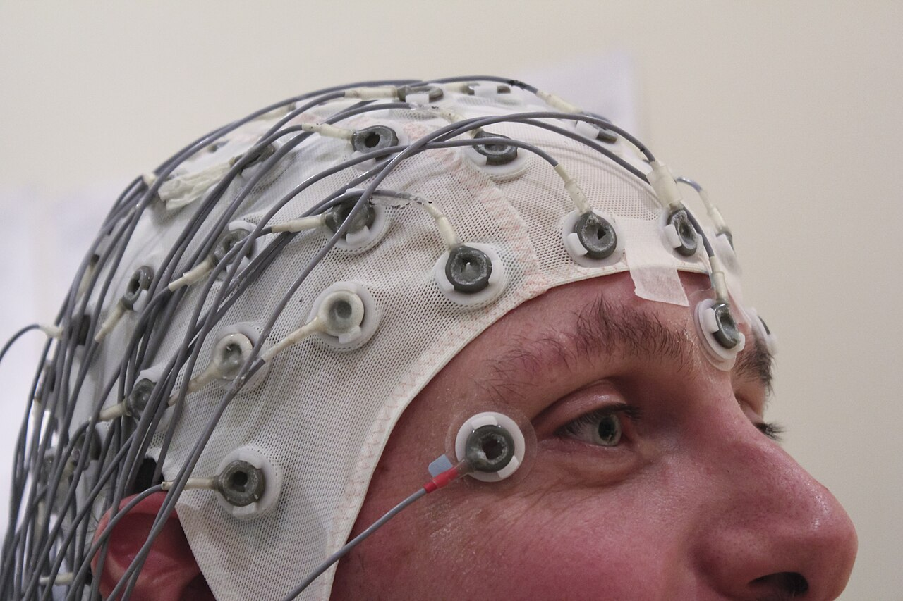

# NeuroStream.IO

Real-time seizure detection on streaming EEG: a validated machine learning model inside a fault-tolerant ingestion and inference pipeline.

<!-- STORY:START (generated by demo/story.py, edit it there) -->
<p align="center"><br><sub>Photo: "EEG Recording Cap" by Chris Hope, <a href="https://commons.wikimedia.org/wiki/File:EEG_Recording_Cap.jpg">CC BY 2.0</a>, via Wikimedia Commons</sub></p>

*Clinical neurophysiology · Machine learning research prototype*

## Can a system recognize a seizure as it happens?

Continuous EEG is how clinicians monitor patients at risk of seizures. Interpreting it is still largely manual, and some seizures show no sign at the bedside. We set out to test whether a model trained on labeled recordings can flag seizure activity within one second of signal, and whether it can run inside a real-time system that keeps working when parts of it fail.

### The problem

- **Review is retrospective.** Trained specialists read EEG, usually after the recording. Hours of signal per patient and a limited number of readers mean findings can arrive late.
- **Some seizures are silent.** Non-convulsive seizures can occur with no visible signs and are recognized only on the EEG.
- **Time matters.** Prolonged seizure activity is harmful and treatable. The sooner it is recognized, the sooner a clinician can act.

### What we wanted to find out

- **Detection:** How accurately can a model flag seizure activity in one-second epochs from recordings it has never seen?
- **Delivery:** Can that model run in a streaming architecture that is validated, observable, and does not lose data when a component fails?

**How it could help.** Continuous screening between specialist reviews. Triage: direct reading time to the segments the model flags first. Earlier notification of the care team.

*Decision support, not a diagnosis. The system flags; a clinician decides.*

### What we did

1. **Data.** 500 single-channel EEG recordings from the University of Bonn: 100 recorded during seizures, 400 seizure-free (healthy volunteers and interictal intracranial recordings).
2. **Validation design.** 75 recordings, 15 of them with seizures, were held out entirely and scored once at the end. Splits are by recording, so no epoch from a test recording appears in training.
3. **Model.** A 1D convolutional neural network reads the normalized waveform together with relative band power (delta to gamma). It trained on about 30,000 one-second epochs with class weighting. The alert threshold was tuned on validation data only.
4. **System.** Around the model: an ingestion gateway, a message queue (Kafka), a preprocessing worker with batching and retries, a gRPC inference service and an alerting step. An automated pipeline rebuilds the stack from scratch and replays held-out recordings end to end on every change.

**Results on 1,725 held-out epochs:** Accuracy 97.6% · Sensitivity 95.1% · Precision (PPV) 93.2% · ROC AUC 0.998

### Limits and next steps

The Bonn recordings are clean, single-channel and short. Clinical EEG is multichannel, noisy and seizure-sparse, which raises the false-alarm burden, so these figures are not evidence of clinical performance. Next: multichannel recordings (CHB-MIT), patient-independent validation, and false alarms per hour. Research prototype, not a medical device.

<sub>Data: Andrzejak et al. (2001), Phys. Rev. E 64, 061907, University of Bonn. Only the 75 held-out test recordings are included in this repository.</sub>
<!-- STORY:END -->

---

## For engineers

```
simulate_patient.py --HTTP--> NestJS gateway --> Kafka (neuro-raw-signals)
                                                    |
                                                    v
                         Python worker (NumPy/SciPy: sliding-window z-score + FFT band powers,
                                        dynamic batching, at-least-once offsets, DLQ)
                                                    | gRPC (proto/inference.proto)
                                                    v
                         ML server (1-D CNN trained on real Bonn EEG, tuned threshold)
                                                    |
                                                    v
                                      worker logs CRITICAL ALERT on seizure
```

## Layout
```
proto/inference.proto            shared gRPC contract
docker-compose.yml               Kafka (KRaft), topic init, ml-server, gateway, worker
services/ingestion-gateway/      NestJS + class-validator + @nestjs/microservices Kafka
services/worker/                 Kafka consumer, preprocessing, batcher, gRPC client, alerting (+ tests)
services/ml-server/              gRPC inference server
simulator/simulate_patient.py    synthetic EEG-like stream with random spikes
```

## Run
```bash
docker compose up -d --build        # first build downloads torch (several minutes); needs models/ from training first
pip install -r simulator/requirements.txt
python simulator/simulate_patient.py --spike-prob 0.3
```

## Train the model (real EEG, real neural network)
```bash
python -m venv .venv && .venv/Scripts/pip install torch --index-url https://download.pytorch.org/whl/cpu
.venv/Scripts/pip install numpy scipy pandas grpcio grpcio-tools protobuf requests pytest
# download Bonn EEG sets z,o,n,f,s from ukbonn.de into training/data/<set>/ (see training/train.py header)
.venv/Scripts/python training/train.py     # writes models/spike_cnn.pt, meta.json, heldout_test_files.json
```
Held-out test result (75 unseen recordings, 1725 one-second windows): accuracy 97.6%, recall 95.1%, precision 93.2%, AUC 0.998.

## No-Docker demo (replays held-out real EEG)
```bash
.venv/Scripts/python demo/run_demo.py --chunks 40
```
Real preprocessing, batching, gRPC client/server, trained CNN and alerting; Kafka and the NestJS gateway are replaced by an in-memory queue and a validation function.

## Verify (three one-liners)
```bash
# 1. Gateway accepts and publishes telemetry
docker compose logs -f ingestion-gateway | grep published
# 2. Messages are really in Kafka
docker compose exec kafka kafka-console-consumer --bootstrap-server kafka:9092 --topic neuro-raw-signals --from-beginning --max-messages 1 | head -c 300
# 3. Worker -> ML server -> closed-loop alert
docker compose logs -f worker | grep -E "CRITICAL ALERT|anomaly="
```
(Windows PowerShell: replace `grep X` with `Select-String X`.) Run the simulator in a separate terminal while these run.

## Tests
```bash
cd services/worker && pip install -r requirements.txt && python -m pytest tests -q   # needs PYTHONPATH=. (set automatically via conftest)
cd services/ingestion-gateway && npm install && npm test   # 14 tests: DTO rules + real HTTP e2e against the actual app with a fake Kafka producer
```

## Design notes / honest caveats
- **Delivery:** at-least-once. Offsets commit only after inference succeeds; if the ML server stays down past the retry budget the worker rewinds and retries. Malformed messages go to `neuro-dead-letter`.
- **Model:** a 1-D CNN trained from scratch on the Bonn EEG benchmark (seizure vs. non-seizure, split by recording). That benchmark is *easy* (published models reach ~99%) and uses clean, single-channel, 1-second windows; it is NOT evidence of clinical performance on real hospital streams (noise, many patients, many channels, much rarer seizures).
- Single-node Kafka, plaintext, no auth: laptop demo only.

## Data attribution
The model is trained on the University of Bonn EEG dataset (Andrzejak et al., 2001, Phys Rev E 64, 061907). Only the 75
held-out test recordings are committed (`data/heldout/`) for the demo and CI; fetch the rest with `python training/download_data.py`.
